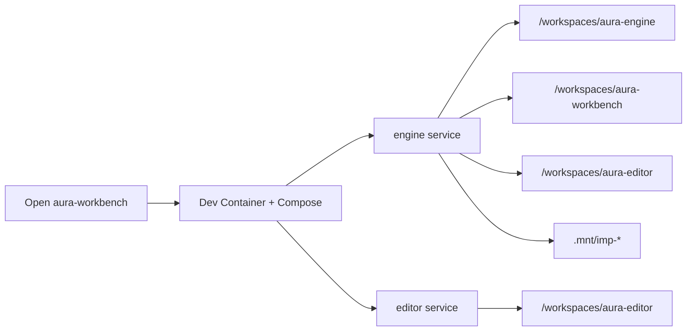

# Aura multi-repo split (workbench-first)

## Decisions (locked)

- **IDE model (1A):** Open `aura-workbench` as primary. Its `.devcontainer` + Compose starts **engine** and **editor** services (`runServices`). Cursor attaches to the **engine** service initially (Rust is the active stack); editor container still comes up. Multi-root workspace file lists workbench + engine + editor (editor tree also mounted into the engine container so one window can see all three).
- **GitHub:** Rename `silentorb/aura` → `silentorb/aura-engine`. Agent updates Cargo `repository` and in-repo links; **you** perform GitHub rename and `git remote` / push-pull.
- **Naming:** repos/projects kebab-case; Rust crates stay snake_case.
- **Rename timing:** Do **not** rename host `~/dev/aura` → `~/dev/aura-engine` until workbench boots successfully against the current `aura` path via a path env var.

## Target layout (host)

```text
~/dev/
  aura-workbench/   # primary Cursor folder
  aura/             # becomes aura-engine after cutover
  aura-editor/
  imp-rust/
  imp-spec/
  imp-ts/
```

## Compose shape (workbench)



Concrete files under **aura-workbench**:

- `docker-compose.yml` — services `engine`, `editor`
- `.env.example` — `AURA_ENGINE_PATH=../aura` (pre-rename), `AURA_EDITOR_PATH=../aura-editor`, Imp paths; copy to `.env` (gitignored)
- `docker/engine/Dockerfile` — Rust + ALSA
- `docker/editor/Dockerfile` — Node bookworm placeholder
- `.devcontainer/devcontainer.json` — Compose, `service: "engine"`, `runServices: ["engine","editor"]`
- `aura.code-workspace` — workbench + engine + editor
- `README.md`, `AGENTS.md`, `.gitignore`
- `.cursor/rules/plan-commit-workflow.mdc`

Pre-cutover: `.env` keeps `AURA_ENGINE_PATH=../aura`. Post-cutover: `../aura-engine`.

## What stays in aura-engine (today’s repo)

Product content: `crates/`, `docs/`, `demos/`, Cargo workspace, product README/AGENTS, `LICENSE`, `.gitignore`.

Agent changes:

- `repository` → `https://github.com/silentorb/aura-engine`
- README / scoping / AGENTS: primary env is **aura-workbench**
- Remove root `.devcontainer` / move Cursor rule to workbench
- Scoping/design: record multi-repo split intent

## aura-editor (new)

Minimal scaffold: `README.md`, `LICENSE`, `.gitignore`, `AGENTS.md`.

---

## Stages (Agent ↔ You)

### Stage 0 — expose siblings (completed)

Temporary mounts on Aura `.devcontainer` for workbench/editor; rebuild.

### Stage 1 — scaffold (completed)

Workbench Compose/Dev Container + editor placeholder; engine path `../aura`.

### Stage 2 — first boot (completed)

Workbench opens; both containers up. Compile issues deferred to follow-up in the new workspace.

### Stage 3 — retarget engine product docs

Update engine docs/AGENTS/README/Cargo `repository`; strip root orchestration.

### Stage 4 — You: cutover rename

- Rename GitHub `silentorb/aura` → `silentorb/aura-engine`; fix local `origin`
- Rename host `~/dev/aura` → `~/dev/aura-engine`
- Set workbench `.env` `AURA_ENGINE_PATH=../aura-engine`
- Reopen workbench; smoke-check
- Create GitHub remotes for workbench/editor when you want

### Stage 5 — Agent: post-cutover polish

Fix path/doc drift; verify mounts.

### Stage 6 — Commits (only when you say **commit**)

One commit per affected repo.

---

## Commit strategy

### Baseline (plan created)

- aura (→ aura-engine): was clean at plan start
- aura-workbench: fresh git init, then scaffolded
- aura-editor: fresh git init, then scaffolded

### Intended commits

#### aura-workbench

- Include: Compose, Dockerfiles, `.devcontainer`, workspace file, README, AGENTS, `.gitignore`, `.env.example`, Cursor rule, restored plan; exclude `.env`
- Draft message: "Add Aura workbench Compose/Dev Container so engine and editor boot as sibling services."

#### aura-engine (current aura)

- Include: doc/AGENTS/README/Cargo repository updates; removal of root `.devcontainer` / Cursor rule
- Exclude: `output/`, `target/`, `.mnt/`
- Draft message: "Treat Aura as aura-engine under the workbench; point repository metadata and env docs at the split."

#### aura-editor

- Include: placeholder README/LICENSE/gitignore/AGENTS
- Draft message: "Initialize aura-editor as the editor sibling mounted by the Aura workbench."

### User trigger

Say **commit** (or **commit per the plan**) after review. Remotes/push remain yours.
